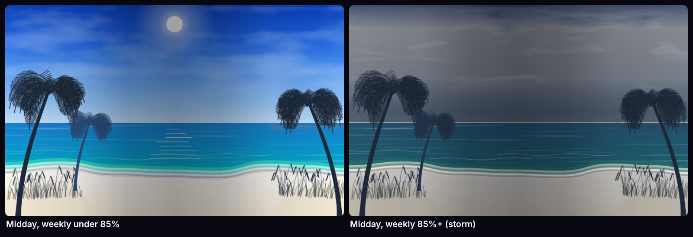

# gulf-sunset

A Florida Gulf-coast beach theme for the Claude desktop and mobile apps, with your usage limits always in view.

- A drawn, gently moving backdrop: white sugar sand, waves washing up the shore, sea oats on the dunes, coconut palms, a distant pier, textured clouds and the Gulf.
- The 5-hour usage window is the time of day, one step every 10%: dawn, sunrise, early morning, morning, midday, afternoon, golden hour, sunset, dusk, night.
- From 85% of the weekly limit a storm rolls in over whatever time it is.
- A centered card above the prompt shows each usage window as a solid bar with its percentage and when it resets.
- Your messages take the color of the time of day; Claude's stay a neutral card. Dark mode sits near true black for OLED screens.

Usage figures come from a Claude subscription and appear after the first reply of a session. The terminal shows the usage card but draws no backdrop.

## Through the day

The scene follows your 5-hour usage window, one step every 10%:

| 5-hour usage | Scene | What you see |
| --- | --- | --- |
| 0–9% | Dawn | The sun still below the Gulf, a pink glow on the horizon |
| 10–19% | Sunrise | The sun breaking the horizon, pastel pink and peach |
| 20–29% | Early morning | Low, warm peach light |
| 30–39% | Morning | Crisp pale blue sky, glassy cyan water |
| 40–49% | Midday | Deep blue sky, few clouds, emerald water, white sand |
| 50–59% | Afternoon | Warm haze, big cumulus, deeper blue-green water |
| 60–69% | Golden hour | Low gold sun, gold-lit clouds |
| 70–79% | Sunset | The sun touching the Gulf, orange and violet sky |
| 80–89% | Dusk | The sun gone, the afterglow fading |
| 90%+ | Night | A crescent moon and stars |


## The weekly limit

The weekly limit stays out of the scene until it nears its cap. From 85% a storm rolls in over whatever time of day it is: dark clouds, a gray sky, dull water and light rain, since the week is then what will stop you.



## Message colors

Your messages take the color of the time of day, deep in dark mode and pale in light mode, and Claude's replies stay a neutral card, so the two are easy to tell apart.


## Install

At the prompt of a Claude Code session:

```
/plugin install gulf-sunset --marketplace tpowell10/ClaudeBeachTheme
```

Answer `y` to add the marketplace, then pick a scope (user, to have it in every project).

From a shell:

```
claude plugin install gulf-sunset --marketplace tpowell10/ClaudeBeachTheme
```

In the desktop app, where `/plugin` does not run: click + next to the prompt box, then Plugins, Add marketplace with `tpowell10/ClaudeBeachTheme`, then Add plugin.

A new session loads the theme when it starts.
