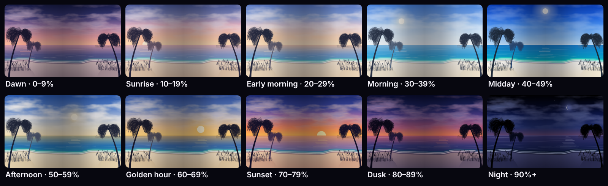
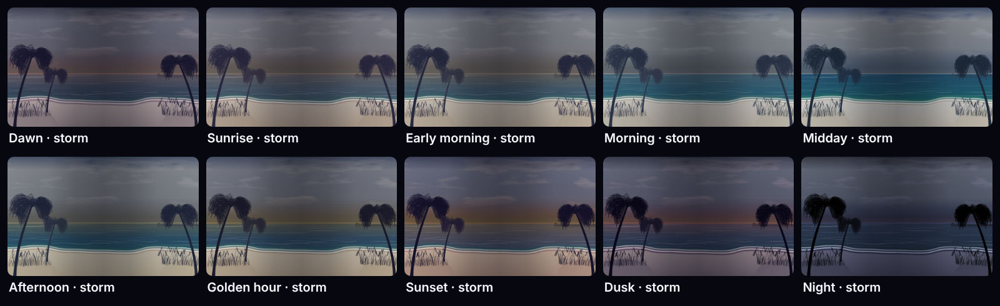
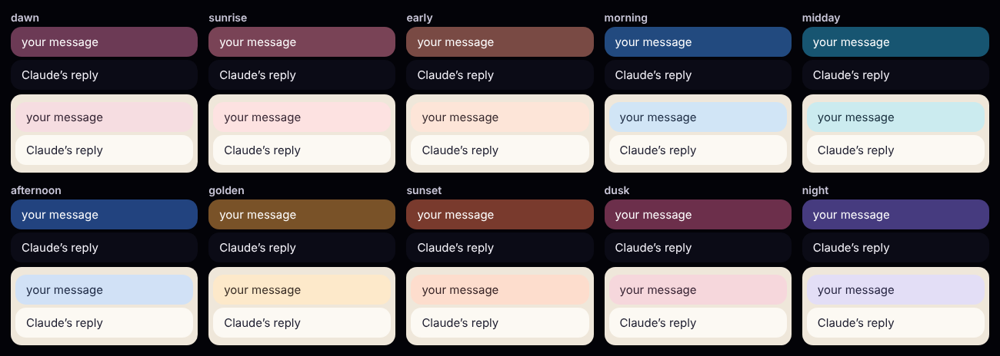

# Beach Theme

A beach theme for Claude Code in the Claude desktop and mobile apps, with your usage limits always in view. It installs as the plugin `gulf-sunset`.



- A drawn, gently moving backdrop: white sugar sand, waves washing up the shore, sea oats on the dunes, coconut palms, a distant pier, textured clouds and the ocean.
- The 5-hour usage window is the time of day, one step every 10%: dawn, sunrise, early morning, morning, midday, afternoon, golden hour, sunset, dusk, night.
- From 85% of the weekly limit a storm rolls in over whatever time it is.
- A centered card above the prompt shows each usage window as a solid bar with its percentage and when it resets.
- Your messages take the color of the time of day; Claude's stay a neutral card. Dark mode sits near true black for OLED screens.

## Install

In the desktop app: click **+** next to the prompt box, then **Plugins**, **Add marketplace** with `tpowell10/ClaudeBeachTheme`, then **Add plugin**.

At the prompt of a Claude Code session:

```
/plugin install gulf-sunset --marketplace tpowell10/ClaudeBeachTheme
```

Answer `y` to add the marketplace, then pick a scope (user, to have it in every project).

From a shell:

```
claude plugin install gulf-sunset --marketplace tpowell10/ClaudeBeachTheme
```

From a downloaded copy: unzip it into a folder that will stay put, then run the same command with that folder's path in place of `tpowell10/ClaudeBeachTheme`.

A new session loads the theme when it starts.

## Where it works

| Where | What you get |
| --- | --- |
| Claude desktop app and mobile app | Everything: the scene, the usage card, message colors and the dark palette |
| Claude Code in a terminal | The usage card and the status line; terminals draw no backdrop |
| Regular claude.ai chats | Not supported: the theme runs in Claude Code sessions |

Usage figures come from a Claude subscription. They appear after the first reply of a session; until then the card says so and the scene shows dawn. An account with no usage limits (an API key, for instance) stays at dawn, and the card says the account reports no limits. Some company accounts only allow approved plugins.

## Through the day

The scene follows your 5-hour usage window, one step every 10% (with no 5-hour reading, the fullest window sets the time):

| 5-hour usage | Scene | What you see |
| --- | --- | --- |
| 0–9% | Dawn | The sun still below the horizon, a pink glow over the water |
| 10–19% | Sunrise | The sun breaking the horizon, pastel pink and peach |
| 20–29% | Early morning | Low, warm peach light |
| 30–39% | Morning | Crisp pale blue sky, glassy cyan water |
| 40–49% | Midday | Deep blue sky, few clouds, emerald water, white sand |
| 50–59% | Afternoon | Warm haze, big cumulus, deeper blue-green water |
| 60–69% | Golden hour | Low gold sun, gold-lit clouds |
| 70–79% | Sunset | The sun touching the water, orange and violet sky |
| 80–89% | Dusk | The sun gone, the afterglow fading |
| 90%+ | Night | A crescent moon and stars |

## The weekly limit

The weekly limit stays out of the scene until it nears its cap. From 85% a storm rolls in over whatever time of day it is: dark clouds, a gray sky, dull water and light rain, since the week is then what will stop you. The storm clears when the weekly limit resets.

Each time of day keeps its own light under the storm, so you can still read the 5-hour window:



## The usage card

Each window gets a solid bar and its percentage, in the scene's colors:

| Usage | Bar color |
| --- | --- |
| Under 50% | Turquoise |
| 50–79% | Sunset orange |
| 80% and up | Coral |

The card also says when each window resets, and the status line repeats the two numbers the scene reads, such as `5-hour 34% · Weekly 9%`. A toast tells you when the time of day changes or a storm rolls in.

## Message colors

Your messages take the color of the time of day, deep in dark mode and pale in light mode, and Claude's replies stay a neutral card, so the two are easy to tell apart.



## Changing it

- **When the scene changes:** `stageAt` and `STORM_FROM` in `hooks/register.tsx`.
- **Colors:** each time of day's sky, sea, sand and sun are in `PALETTES` in `hooks/scene.ts`; the accent and your message color come from `ACCENTS` in `hooks/register.tsx`.
- **The usage card:** `levelColor` and the card at the end of `hooks/register.tsx`.

After a change, `claude plugin test .` in this folder runs the tests in `tests/`: which scene each usage level picks, the storm coming and clearing, and what the usage card shows.

## License

MIT, in `LICENSE`.
